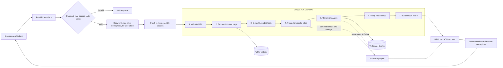
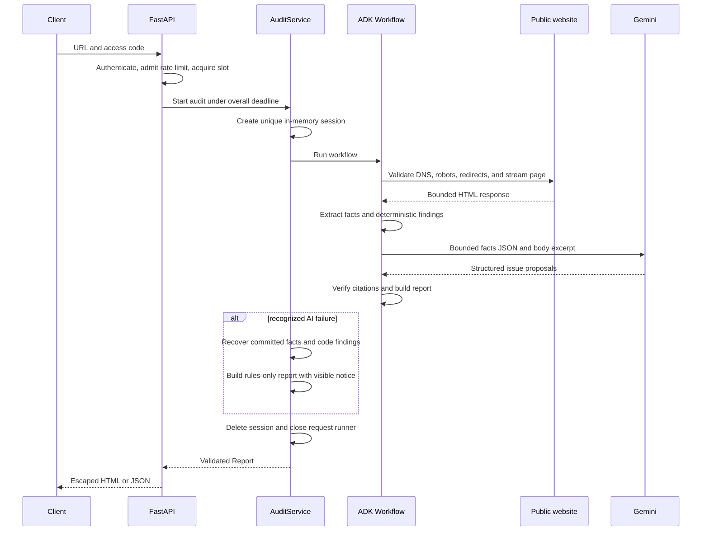

# SEO Audit Agent

SEO Audit Agent is a security-conscious FastAPI service that audits a public web page and returns an evidence-backed SEO report. It combines deterministic Python checks with a bounded Google ADK/Gemini review: code measures objective page properties, the model proposes only subjective findings, and Python verifies every model citation before it can appear in the final report.

The service is designed for agency and technical-review workflows where explainability matters more than a synthetic score. Every finding includes a stable category, severity, source, evidence, explanation, and suggested fix. The application produces a browser-friendly HTML report and an equivalent JSON response from the same validated report model.

## What the service does

- Accepts one public `http://` or `https://` page URL per audit.
- Consults `robots.txt` before fetching the page and before following each page redirect.
- Defends the fetch path against SSRF, unsafe redirects, oversized responses, proxy leakage, and unsupported media.
- Extracts a bounded set of SEO facts without retaining or displaying raw HTML.
- Runs deterministic checks for titles, descriptions, headings, image alternatives, canonical metadata, viewport, language, content length, and Open Graph metadata.
- Sends bounded facts and a short body-text excerpt to a tool-free Gemini agent for four subjective review categories.
- Accepts an AI finding only when its quoted text or metric exactly matches the extracted evidence.
- Returns deterministic results even when the AI provider is unavailable.
- Serves printable HTML and machine-readable JSON without persisting reports.

This is a single-page auditor, not a site-wide crawler. It does not execute JavaScript, log into websites, bypass robots policy, fetch linked assets, compute a numerical SEO score, or claim to predict search ranking.

## Architecture



### Request lifecycle



## Core design

### Deterministic analysis

Objective measurements are calculated in Python. These findings do not depend on the model and remain available during provider failures.

| Finding identifier | Severity | Trigger |
| --- | --- | --- |
| `title_missing` | high | No non-empty document title |
| `title_too_short` | medium | Normalized title is shorter than 30 characters |
| `title_too_long` | medium | Normalized title is longer than 60 characters |
| `meta_description_missing` | medium | No non-empty meta description |
| `meta_description_length` | low | Description length is outside 70–160 characters |
| `h1_count` | medium | The page does not contain exactly one H1 |
| `images_without_alt` | medium | One or more images omit the `alt` attribute |
| `canonical_missing` | medium | No non-empty canonical link target |
| `viewport_missing` | medium | No non-empty viewport meta value |
| `html_lang_missing` | low | The root HTML element has no non-empty language value |
| `low_word_count` | low | Extracted visible body text contains fewer than 300 word tokens |
| `open_graph_missing` | low | No metadata property begins with `og:` |

An empty `alt=""` is treated as intentional decorative-image markup; only an absent attribute is flagged. These thresholds are practical heuristics, not ranking guarantees.

### Extracted facts

The `Facts` contract records:

- final page URL;
- title and normalized title length;
- meta description and normalized description length;
- H1 count and bounded H1–H6 text samples;
- image count, missing-alt count, and bounded alt-text samples;
- bounded link-text samples;
- canonical URL, viewport value, and HTML language;
- visible-text word count;
- Open Graph metadata count.

Beautiful Soup uses Python's `html.parser`. The extractor removes `script`, `style`, `noscript`, and `template` content, and excludes the document head from body text. Counts cover the full parsed response while evidence samples are bounded. It retains at most 20 headings, 20 link texts, and 20 alt texts, with each sample capped at 300 characters. The stored title is capped at 1,000 characters, description at 2,000, and body excerpt at 6,000. Word counting uses approximate Unicode word tokens and is not language-aware segmentation.

### AI review

The `LlmAgent` can propose issues in exactly four subjective categories:

- `title_quality`
- `keyword_stuffing`
- `heading_quality`
- `cta_quality`

The model receives no tools, no raw HTML, and no session history. Its input contains a JSON-compatible projection of `Facts` capped at 32,000 encoded characters and at most 6,000 characters of visible body text. Untrusted page content is explicitly delimited and angle brackets are escaped so page text cannot forge prompt boundaries. Generation uses temperature `0` and a 4,096-token output ceiling.

The response is bounded to 30 proposals and 128 KiB of raw JSON text. Each proposal must contain a non-blank title, explanation, fix, supported category and severity, plus exactly one supported evidence mode.

### Evidence verification

AI output is treated as untrusted data. It cannot directly create a report finding.

For quote evidence, the verifier collapses whitespace and applies Unicode case folding, then requires the proposed quote to be an exact substring of retained title, description, heading, link, alt-text, or body evidence. It deliberately performs no fuzzy, punctuation, or semantic matching.

For metric evidence, the proposal must reference a known scalar `Facts` field and provide the exact Python type and value. For example, `true`, `1.0`, and `"1"` cannot substitute for integer `1`. Lists, dictionaries, dotted paths, and unknown fact names are rejected.

Malformed proposals are dropped individually so valid neighboring items can survive. The report records proposed, verified, and dropped counts separately. Verification proves only that the cited text or measurement exists in the extracted evidence; it does not prove that the model's subjective conclusion is correct.

### Graceful degradation

Transient model and provider failures use bounded retries. A recognized exhausted AI failure causes `AuditService` to read the facts and deterministic findings already committed to the session, then build a rules-only report with the visible notice **AI review unavailable**.

Security denials, robots refusals, page-fetch failures, extraction errors, verification programming errors, and unrelated exceptions are not mislabeled as AI failures. An overall timeout or client cancellation propagates and still triggers cleanup.

## Fetch and SSRF security

The audit target is hostile input. Fetching is performed with explicit controls at every network boundary.

### URL and address validation

- Only HTTP and HTTPS are accepted.
- Only ports 80 and 443 are allowed.
- User information, control characters, whitespace, backslashes, ambiguous host forms, and URLs longer than 2,048 characters are rejected.
- Hostnames are resolved with `socket.getaddrinfo`; every returned address must be globally routable.
- Private, loopback, link-local, multicast, reserved, unspecified, and otherwise non-global addresses are blocked.
- IPv4-mapped IPv6 addresses are normalized before classification.
- `metadata.google.internal` and `169.254.169.254` are explicitly denied.
- Mixed public/private DNS answers are rejected rather than selecting only the public address.

### HTTP controls

- HTTPX environment proxy discovery is disabled with `trust_env=False`.
- TLS certificate verification remains enabled.
- Automatic redirects are disabled; at most three redirects are followed manually.
- Every redirect destination is URL-validated, DNS-validated, and checked against robots policy before it is fetched.
- Cookies are cleared and not replayed as a browsing session.
- Requests advertise identity encoding; responses that remain compressed are refused before unbounded decompression.
- Connect timeout is 5 seconds; DNS, robots, redirects, page streaming, and retries share a 10-second total fetch deadline.
- HTML is streamed and capped at 2 MiB; `robots.txt` is capped at 512 KiB.
- Page responses must be `text/html` or `application/xhtml+xml`.

Validation and connection resolution are separate operations, so DNS rebinding remains a residual risk. A higher-assurance deployment would connect to a previously validated address while preserving TLS hostname verification, or place fetching behind an isolated egress proxy that enforces destinations.

### Robots policy

`robots.txt` is fetched through the same URL, DNS, redirect, timeout, and size controls as the page. A 404 or 410 means no policy is present. Authentication failures, network failures, malformed responses, and exhausted transient errors fail closed. Policies are cached only within one audit and each redirected page destination is checked.

The local matcher supports exact product-token groups, merged groups, wildcard fallback, percent normalization, `*`, terminal `$`, longest-match selection, and allow-on-equal-specificity behavior. Robots compliance is a service policy and does not grant permission to ignore a site's terms or applicable law.

## ADK workflow and state

The application uses one `google.adk.workflow.Workflow` with this fixed graph:

```text
START
  -> validate_url
  -> fetch_page
  -> extract_facts
  -> rule_findings
  -> auditor (LlmAgent)
  -> verify
  -> build_report
```

Six code nodes surround a tool-free `LlmAgent`. Node state contains JSON-serializable values only. Completed nodes replace state entries rather than mutating nested values, which makes partial state recovery predictable. Raw HTML is removed from current state after extraction. A fresh in-memory session is created for each audit and deleted after success, failure, timeout, or cancellation; reports are never stored server-side.

Transient fetch and model work use at most three attempts with 0.5-second initial delay, exponential backoff capped at 1 second, and no multiplied SDK retry loop. Each model node attempt has a 15-second timeout. The service-level audit deadline is 90 seconds.

## HTTP application

| Method and path | Input | Result |
| --- | --- | --- |
| `GET /` | None | Browser form for URL and access code |
| `GET /healthz` | None | `{"status":"ok"}` without initializing the model |
| `POST /audit` | Form fields `url` and `access_code` | Printable HTML report |
| `POST /api/audit` | JSON object with `url` and `access_code` | JSON representation of the same report |

OpenAPI and Swagger UI routes are disabled. Both audit endpoints enforce the same authentication, quota, concurrency, deadline, cleanup, and error behavior.

### Authentication and admission control

`ACCESS_CODE` is a shared application secret intended to keep a demo or internal service from becoming an unauthenticated public scraping endpoint. Submitted and configured values are compared as UTF-8 bytes with `hmac.compare_digest`. Authentication happens before URL validation, quota admission, fetching, or model work.

Authenticated attempts are limited to five per client peer address in a sliding one-hour window. The limiter keeps no more than 4,096 active client buckets. Unauthenticated attempts do not consume the audit quota. The application uses the ASGI peer address and does not trust arbitrary `Forwarded` or `X-Forwarded-For` headers.

A process-wide semaphore allows two active audits. Queue time, request parsing, workflow work, and report rendering all count toward the 90-second request deadline. These controls are in memory and therefore apply per process and per Cloud Run instance; they are abuse safeguards, not distributed billing or identity controls.

### Request and response safety

- Request bodies are limited to 16 KiB, including chunked bodies.
- Duplicate fields, extra fields, malformed payloads, and file uploads are rejected.
- Jinja2 autoescape is always enabled and undefined template values are errors.
- Page and model strings are displayed as text, never trusted markup.
- The JSON download is built from the validated `Report`, base64 encoded as `application/json`, and handled by the browser without server-side storage or executable JavaScript.
- Responses use `Cache-Control: no-store`, `X-Content-Type-Options: nosniff`, `Referrer-Policy: no-referrer`, and a restrictive script-free Content Security Policy.
- Reports include print CSS for sharing or saving as PDF from the browser.

### Status codes

| Status | Meaning |
| --- | --- |
| `200` | Successful complete or rules-only audit |
| `400` | Invalid or unsafe URL, or malformed request fields |
| `401` | Missing or incorrect access code |
| `403` | Robots policy refuses the requested page |
| `413` | Request or fetched resource exceeds its limit |
| `415` | Unsupported request or page media type |
| `429` | Per-client audit limit exceeded; includes `Retry-After` |
| `500` | Sanitized unexpected server error |
| `502` | Remote page could not be fetched safely |
| `504` | Overall request deadline exceeded |

A client disconnect cancels work and is recorded internally as status 499 when observable.

## Report contract

Both output formats are rendered from the same Pydantic `Report` model. A report contains:

- audited URL and extracted `Facts`;
- deterministic and verified-AI findings;
- finding source labels: `code check` or `AI, verified`;
- severity totals;
- AI proposal, verification, and drop counts when review completed;
- AI availability and a visible degradation notice where applicable;
- review mode, model identity, and installed ADK version;
- timezone-aware UTC generation timestamp;
- explicit limitations.

No numerical SEO score is calculated. Severity is an actionable triage label, not a ranking prediction.

Example API request in PowerShell, keeping the access code out of the command text:

```powershell
$auditCode = Read-Host "Access code" -AsSecureString
$plainAuditCode = [System.Net.NetworkCredential]::new("", $auditCode).Password
$payload = @{ url = "https://example.com/"; access_code = $plainAuditCode } | ConvertTo-Json
Invoke-RestMethod -Method Post -Uri "http://127.0.0.1:8080/api/audit" -ContentType "application/json" -Body $payload
Remove-Variable plainAuditCode, payload
```

## Configuration

The application reads explicit environment variables and does not automatically load `.env`. Use [`.env.example`](.env.example) as a reference, but never commit a populated `.env` file.

| Variable | Required | Purpose |
| --- | --- | --- |
| `ACCESS_CODE` | yes | Shared audit access secret, with no default |
| `MODEL_NAME` | yes | Explicit Gemini model identifier; verify current regional availability |
| `CONTACT_URL` | yes | Public HTTP(S) contact page included in the fetch User-Agent |
| `GOOGLE_GENAI_USE_ENTERPRISE` | yes for Vertex | Set to `1` to use Vertex AI with Application Default Credentials |
| `GOOGLE_CLOUD_PROJECT` | Vertex mode | Google Cloud project containing Vertex AI resources |
| `GOOGLE_CLOUD_LOCATION` | Vertex mode | Vertex AI model region |
| `GOOGLE_API_KEY` | local API-key mode only | Optional local alternative when enterprise mode is disabled; never deploy it |
| `DEV_STUB_MODEL` | no | Explicit local-only model stub; disabled by default and rejected on Cloud Run |
| `LOG_LEVEL` | no | Structured-log threshold, normally `INFO` |
| `ADK_CAPTURE_MESSAGE_CONTENT_IN_SPANS` | enforced | Set to `false` to prevent message-content span capture |
| `OTEL_INSTRUMENTATION_GENAI_CAPTURE_MESSAGE_CONTENT` | enforced | Set to `NO_CONTENT` |
| `ADK_EXPERIMENTAL_TELEMETRY` | enforced | Set to `false` |
| `ADK_EXPERIMENTAL_TELEMETRY_FEATURES` | enforced | Leave empty |
| `PROJECT_ID` | deployment scripts | Target Google Cloud project |
| `REGION` | deployment scripts | Cloud Run region, which may differ from the model region |
| `PYTHON_BIN` | deployment scripts | Optional Python executable used by Bash helpers |

When `K_SERVICE` identifies Cloud Run, startup rejects development stub mode, API-key mode, and file-based `GOOGLE_APPLICATION_CREDENTIALS`. Production uses the attached runtime service account through Application Default Credentials.

## Local development

Python 3.12 is required.

```powershell
py -3.12 -m venv .venv
.\.venv\Scripts\python.exe -m pip install --upgrade pip
.\.venv\Scripts\python.exe -m pip install -r requirements.txt
.\.venv\Scripts\python.exe -m pytest -q
```

Normal tests require no credentials and no Internet connection. An autouse test guard rejects unexpected DNS and socket use; website and model interactions are mocked.

### Start with the local model stub

Stub mode still fetches the real public target and applies all network controls. Only Gemini is replaced with an empty proposal response, and the report is visibly labeled `stub`.

```powershell
$secret = Read-Host "Choose a private access code" -AsSecureString
$env:ACCESS_CODE = [System.Net.NetworkCredential]::new("", $secret).Password
$env:MODEL_NAME = "local-stub"
$env:CONTACT_URL = "https://your-domain.example/contact"
$env:DEV_STUB_MODEL = "true"
$env:LOG_LEVEL = "INFO"
.\.venv\Scripts\python.exe -m uvicorn app.server:app --host 127.0.0.1 --port 8080 --no-proxy-headers --no-access-log
```

Open `http://127.0.0.1:8080/`. Replace the example contact URL with a real public URL where a site owner can identify or contact the operator.

### Start with Vertex AI

Authenticate locally with Application Default Credentials, select a model available in your project and region, then set:

```powershell
$env:DEV_STUB_MODEL = "false"
$env:GOOGLE_GENAI_USE_ENTERPRISE = "1"
$env:GOOGLE_CLOUD_PROJECT = "YOUR_PROJECT_ID"
$env:GOOGLE_CLOUD_LOCATION = "YOUR_MODEL_REGION"
$env:MODEL_NAME = "YOUR_VERIFIED_MODEL_NAME"
```

Keep the access code and contact URL configured as above. Live requests can incur Google Cloud charges.

## Testing and evaluation

The repository contains offline tests for:

- URL ambiguity, metadata targets, IPv4/IPv6 edge cases, mixed DNS answers, and redirect revalidation;
- robots parsing, redirect policy, error behavior, size limits, and timeouts;
- bounded extraction, malformed HTML, and every deterministic rule boundary;
- quote normalization, exact metric typing, fabricated evidence, malformed model output, and proposal limits;
- prompt-injection fixtures, forged delimiters, bounded model input, retries, and rules-only recovery;
- XSS escaping in rendered HTML and serialized download data;
- authentication, request limits, rate limiting, concurrency, cancellation, session cleanup, and safe error mappings;
- structured logging privacy and dependency-log redaction;
- container behavior and deployment-command construction.

Run the complete suite:

```powershell
.\.venv\Scripts\python.exe -m pytest -q
```

The current suite contains 388 passing offline tests. The remaining warning is an upstream Starlette `TestClient` deprecation notice in the pinned compatibility path.

### Saved-page evaluation

Ten synthetic HTML fixtures cover all 12 deterministic finding identifiers:

```powershell
.\.venv\Scripts\python.exe eval/run_eval.py
```

The recorded regression result is 20 expected findings, 20 true positives, 0 false positives, and 0 false negatives. This is an exact fixture regression check, not evidence of effectiveness on arbitrary websites or search performance. See [evaluation methodology](eval/README.md) and [recorded results](eval/RESULTS.md).

An opt-in live review adds AI proposed, verified, and dropped counts:

```powershell
.\.venv\Scripts\python.exe eval/run_eval.py --live
```

That command requires valid Vertex configuration and may be billable.

## Container image

The Docker image uses `python:3.12-slim`, installs pinned dependencies, copies only runtime application files, and runs as non-root UID/GID `10001`. It starts one Uvicorn worker, expands Cloud Run's `PORT`, disables proxy-header rewriting and access logs, and uses `exec` for correct signal handling.

```powershell
docker build --tag seo-audit-agent:local .
.\.venv\Scripts\python.exe scripts/smoke_container.py
```

The smoke script uses an ephemeral container with external networking disabled, a read-only filesystem, and dropped capabilities. It checks the health and form endpoints, authentication failures, invalid audit requests, JSON logs, non-root identity, runtime versions, port expansion, and Cloud Run rejection of stub mode.

For an interactive stub container, set `ACCESS_CODE` and `CONTACT_URL` in the parent shell, then run:

```powershell
docker run --rm -p 127.0.0.1:8080:8080 `
  --env ACCESS_CODE `
  --env CONTACT_URL `
  --env MODEL_NAME=local-stub `
  --env DEV_STUB_MODEL=true `
  seo-audit-agent:local
```

Do not bake credentials into the image or mount an entire home directory for ADC.

## Google Cloud deployment

The production design uses Cloud Run, Vertex AI, Secret Manager, Artifact Registry, Cloud Build, and Cloud Logging. Follow the complete [GCP deployment guide](docs/GCP_SETUP.md).

The supplied scripts separate identities:

- `seo-audit-sa` is the Cloud Run runtime identity. It receives Vertex AI user, Logging writer, and access to only the audit access-code secret.
- `seo-audit-build` is the Cloud Build identity. It receives the permissions required to build and deploy the service.
- The human administrator retains control of project setup and supplies the secret value privately; scripts do not create a default secret value.

The deployment uses one CPU, 1 GiB memory, one application worker, concurrency 4, minimum 0 instances, maximum 2 instances, and a 120-second platform timeout around the application's 90-second deadline. The optional `--demo-day` flag sets the minimum instance count to 1 to reduce cold starts.

```bash
export PROJECT_ID="your-project-id"
export REGION="your-cloud-run-region"
export GOOGLE_CLOUD_LOCATION="your-vertex-region"
export MODEL_NAME="your-verified-model-name"
export CONTACT_URL="https://your-domain.example/contact"

bash deploy/setup_gcp.sh
# Add ACCESS_CODE as a Secret Manager version using the secure procedure in docs/GCP_SETUP.md.
bash deploy/deploy.sh
```

Runtime configuration is passed through a temporary JSON environment file so shell-sensitive contact values cannot become command flags. The access code is mounted from Secret Manager rather than sent as a deployment argument. The scripts use an explicit project for cloud commands and do not silently change the CLI's configured project.

Cloud Run is intentionally public at the transport layer so browser and API clients can reach it; the application access code protects audit execution. This is appropriate for a controlled demo or internal shared tool. A broader multi-tenant product should replace the shared code with identity-aware authentication, durable quotas, per-tenant accounting, and a distributed job system.

## Logging and privacy

Application logs are allowlisted JSON written to standard output. They include locally generated request ID, route, status, duration, and controlled event names. They exclude access codes, URLs with query strings, client IPs, request bodies, page content, model prompts and responses, arbitrary exception messages, and stack traces.

ADK, GenAI, HTTP client, Uvicorn, and asyncio records pass through a privacy guard that strips unsafe message arguments and exception content. Model-content telemetry is explicitly disabled. The service has no report database, analytics store, or persistent session store.

## Repository layout

```text
app/
  server.py                 FastAPI routes, middleware, error mapping, and lifespan
  runtime.py                Live Gemini and local-stub model ownership
  limits.py                 Sliding-window limiter and concurrency admission
  templates/                Autoescaped form, report, and error templates
seo_audit/
  config.py                 Environment validation and secret-safe settings
  security.py               URL, DNS, redirect, and bounded HTTP controls
  robots.py                 Fail-closed robots retrieval and matching
  extract.py                Bounded HTML fact extraction
  rules.py                  Deterministic SEO findings
  models.py                 Facts, issues, findings, audits, and report contracts
  prompts.py                Bounded untrusted-content projection for Gemini
  nodes.py                  ADK code-node implementations
  workflow.py               Seven-step ADK graph construction
  service.py                Session lifecycle, deadlines, and AI degradation
  verify.py                 Quote and metric evidence verification
  report.py                 HTML and JSON rendering from one Report model
  logging_utils.py          Structured allowlisted logging and redaction
tests/                      Offline security, workflow, report, and API tests
eval/                       Saved HTML regression corpus and evaluator
deploy/                     Idempotent GCP setup and deployment scripts
docs/                       Deployment, ADK inspection, and design references
scripts/                    Dependency inspection and container smoke checks
Dockerfile                  Non-root Python 3.12 runtime image
requirements.txt            Direct pinned application dependencies
requirements.lock           Fully resolved dependency constraints
```

## Known limitations

- The service audits one fetched HTML document, not an entire site.
- It does not execute JavaScript, render a browser DOM, inspect post-hydration metadata, or capture Core Web Vitals. A future browser-rendering design is documented in [modern-page support](docs/MODERN_PAGE_SUPPORT_PLAN.md), but it is not part of the current runtime.
- It does not fetch linked CSS, JavaScript, images, sitemaps, structured-data resources, or backlinks.
- Bounded evidence samples mean a valid AI citation outside retained text will be dropped even though full-document counts remain accurate.
- Exact evidence matching prevents fabricated citations but cannot guarantee that an AI recommendation is sensible.
- SEO thresholds and severity labels are heuristics and should be reviewed by a practitioner.
- The HTML parser is fault tolerant but is not a browser and can interpret malformed markup differently.
- DNS rebinding remains possible between address validation and connection resolution.
- Rate limits and concurrency controls are per process and per instance, not distributed.
- Peer-address behavior behind Cloud Run's proxy must be validated for the intended deployment; multiple clients may share a quota bucket.
- No report is persisted, so clients must save the HTML, print to PDF, or download JSON before leaving the page.

## Technology stack

| Component | Technology |
| --- | --- |
| Runtime | Python 3.12 |
| API | FastAPI 0.162 and Uvicorn 0.54 |
| Agent orchestration | Google ADK 2.13.0 |
| Model SDK | Google Gen AI 2.33.0 |
| Validation | Pydantic 2.14.1 |
| HTTP client | HTTPX 0.28.1 |
| HTML parsing | Beautiful Soup 4.15 |
| Templates | Jinja2 3.1.6 with forced autoescape |
| Tests | pytest 9.2 |
| Production platform | Cloud Run with Vertex AI and Secret Manager |

Dependencies are pinned because the workflow, structured-output, retry, model-client, and environment-selection behavior is inspected against these exact versions. `GOOGLE_GENAI_USE_ENTERPRISE=1` selects Vertex AI; the project uses that current switch rather than the deprecated Vertex alias.

## Responsible use

Audit only public pages you are authorized to review. Respect robots policy, website terms, rate limits, copyright, privacy obligations, and applicable law. Findings are an automated first pass and should be validated by a human before client delivery or production changes.
